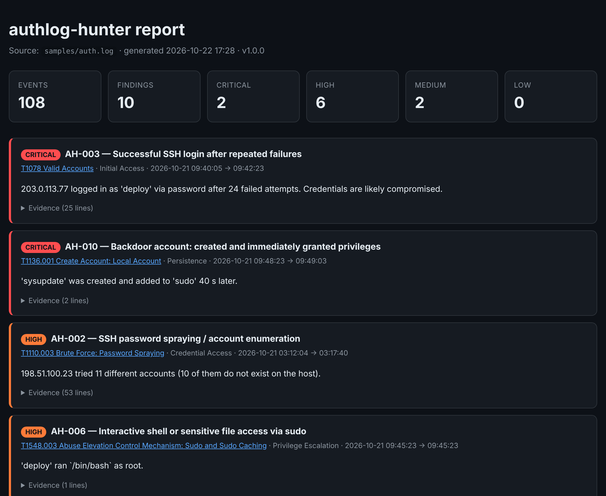

<h1 align="center">authlog-hunter</h1>

<p align="center">
  <b>Threat detection for Linux authentication logs, mapped to MITRE ATT&CK</b><br>
  Turns raw <code>auth.log</code> / <code>secure</code> into prioritized incidents, an HTML report and an ATT&CK Navigator layer.
</p>

<p align="center">
  
  
  
  
  
</p>

<p align="center"></p>

## Why

Every internet-facing Linux server is hit by SSH brute force within minutes of going online. The signal that actually matters — *a brute force that succeeded*, *a fresh account quietly added to `sudo`* — gets buried in thousands of identical lines. `authlog-hunter` correlates events across time, users and source IPs and surfaces what an analyst should look at first.

- **Zero dependencies** — pure Python standard library, runs on any server or air-gapped host (including Astra Linux, Debian, RHEL family)
- **Correlation, not grep** — sliding time windows, multi-stage attack chains, trusted-network allowlists
- **Analyst-friendly output** — colored console, JSON for SIEM/SOAR, standalone HTML report with evidence lines
- **ATT&CK Navigator layer** — drop the JSON into [ATT&CK Navigator](https://mitre-attack.github.io/attack-navigator/) to see the attack on the matrix
- **Automation-ready** — `--fail-on high` returns exit code 3 for cron/CI alerting

## Detection rules

| ID | Detection | Severity | ATT&CK technique | Tactic |
|---|---|---|---|---|
| AH-001 | SSH password brute force (N failures from one IP within a window) | medium | [T1110.001](https://attack.mitre.org/techniques/T1110/001/) Password Guessing | Credential Access |
| AH-002 | Password spraying / account enumeration (many usernames from one IP) | high | [T1110.003](https://attack.mitre.org/techniques/T1110/003/) Password Spraying | Credential Access |
| AH-003 | **Successful login after repeated failures** | critical | [T1078](https://attack.mitre.org/techniques/T1078/) Valid Accounts | Initial Access |
| AH-004 | Direct SSH login as root | high | [T1078.003](https://attack.mitre.org/techniques/T1078/003/) Local Accounts | Privilege Escalation |
| AH-005 | SSH login outside working hours | low | [T1078](https://attack.mitre.org/techniques/T1078/) Valid Accounts | Defense Evasion |
| AH-006 | Shell or sensitive file access via sudo (`bash`, `/etc/shadow`, GTFOBins-style binaries) | high | [T1548.003](https://attack.mitre.org/techniques/T1548/003/) Sudo and Sudo Caching | Privilege Escalation |
| AH-007 | Unauthorized sudo attempts / user not in sudoers | medium | [T1548.003](https://attack.mitre.org/techniques/T1548/003/) Sudo and Sudo Caching | Privilege Escalation |
| AH-008 | New local account created (flags system-range UIDs) | medium/high | [T1136.001](https://attack.mitre.org/techniques/T1136/001/) Local Account | Persistence |
| AH-009 | User added to a privileged group (`sudo`, `wheel`, `docker`, `astra-admin`, …) | high | [T1098](https://attack.mitre.org/techniques/T1098/) Account Manipulation | Persistence |
| AH-010 | **Backdoor chain:** account created and promoted within 15 minutes | critical | [T1136.001](https://attack.mitre.org/techniques/T1136/001/) Local Account | Persistence |

## Quick start

```bash
git clone https://github.com/Sashagran/authlog-hunter.git
cd authlog-hunter

# run against the bundled synthetic incident
python -m authlog_hunter samples/auth.log --year 2026 \
    --html report.html --navigator layer.json

# real server (rotated .gz logs supported)
sudo python -m authlog_hunter /var/log/auth.log /var/log/auth.log.2.gz \
    --trusted 10.0.0.0/8 --min-severity medium

# journald hosts
journalctl -t sshd -t sudo -t useradd -t usermod -o short-iso | python -m authlog_hunter -
```

Or install it as a command: `pip install .` → `authlog-hunter --help`.

<details>
<summary><b>Example console output</b></summary>

```text
authlog-hunter 1.0.0 | 108 security events | 10 findings
  critical: 2  high: 6  medium: 2  low: 0

[CRITICAL] AH-003 Successful SSH login after repeated failures
           T1078 Valid Accounts (Initial Access)
           2026-10-21 09:40:05 -> 09:42:23  203.0.113.77 logged in as 'deploy' via password after 24 failed attempts.

[CRITICAL] AH-010 Backdoor account: created and immediately granted privileges
           T1136.001 Create Account: Local Account (Persistence)
           2026-10-21 09:48:23 -> 09:49:03  'sysupdate' was created and added to 'sudo' 40 s later.

[HIGH    ] AH-002 SSH password spraying / account enumeration
           T1110.003 Brute Force: Password Spraying (Credential Access)
           2026-10-21 03:12:04 -> 03:17:40  198.51.100.23 tried 11 different accounts (10 of them do not exist on the host).
...
```
</details>

## The sample incident

[`samples/auth.log`](samples/auth.log) is generated by [`samples/generate_sample.py`](samples/generate_sample.py) and tells a complete attack story (documentation IP ranges, fictional users):

1. **03:12** — night-time password spraying across 11 usernames
2. **09:40** — focused brute force against `deploy` → **successful login**
3. **09:45** — `sudo /bin/bash`, then reading `/etc/shadow`
4. **09:48** — backdoor account `sysupdate` (UID 998) created and added to `sudo` 40 seconds later
5. **09:54** — direct root login from the attacker IP
6. **10:05** — an unrelated insider probing sudo without permissions

The tool reconstructs every stage. See the generated [HTML report](docs/sample-report.html) and [Navigator layer](docs/sample-navigator-layer.json).

## Architecture

```text
auth.log ──► parser.py ──► normalized Event stream ──► detectors.py ──► Finding[] ──► report.py
            (BSD + RFC3339       (kind, user, src_ip,       (sliding windows,         ├─ console / JSON
             timestamps, .gz)     timestamp, evidence)       correlation chains)       ├─ HTML report
                                                                                       └─ ATT&CK Navigator layer
```

Adding a rule is one function decorated with `@detector` that receives the ordered event stream and returns `Finding` objects.

## Tests

```bash
python -m unittest discover -s tests -v
```

The suite covers parsing edge cases (IPv6, RFC 3339, gshadow duplicates), rule thresholds and windows, trusted networks, the full sample story and CLI exit codes. CI runs on Python 3.10–3.13.

## Roadmap

- Sigma rule export for each detection
- GeoIP / ASN enrichment for source addresses
- Windows Security log (4625/4624/4720/4732) support

## License

MIT © Alexander Zheltov
